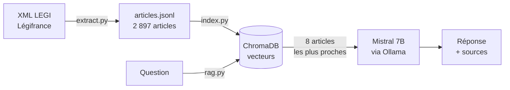

# RAG Lois : poser des questions sur le Code civil

Assistant qui répond à des questions de droit français **en citant les articles de loi** sur lesquels il s'appuie.
Projet de RAG (Retrieval-Augmented Generation) construit de A à Z, entièrement en local et gratuit.

> ⚠️ Information générale, pas un conseil juridique.

## Comment ça marche



1. **Extraction** (`extract.py`) : lit les fichiers XML open data de Légifrance (base LEGI) et garde les articles du Code civil en vigueur.
2. **Indexation** (`index.py`) : transforme chaque article en vecteur avec le modèle `multilingual-e5-base`, puis le range dans ChromaDB.
3. **Recherche** (`rag.py`) : transforme la question en vecteur et retrouve les 8 articles les plus proches par similarité cosinus.
4. **Génération** (`rag.py`) : Mistral rédige la réponse uniquement à partir de ces articles, en les citant.
5. **Interface** (`app.py`) : une application web Flask qui affiche la réponse et des liens vers Légifrance.

## Stack

| Rôle | Outil |
|---|---|
| Données | Légifrance, base LEGI (open data) |
| Parsing XML | lxml |
| Embeddings | sentence-transformers, `intfloat/multilingual-e5-base` |
| Base vectorielle | ChromaDB (index HNSW) |
| LLM | Mistral 7B via Ollama (local) |
| Web | Flask + HTML/JS |

## Résultats

Évaluation de la recherche sur 7 questions dont on connaît l'article attendu (`eval.py`), avec la mesure **hit rate@k** : le bon article est-il dans les k premiers résultats ?

| Mesure | Avant | Après correction |
|---|---|---|
| Top-1 | 43 % | **57 %** |
| Top-3 | 71 % | **86 %** |
| Top-8 | 71 % | **86 %** |

**Le bug trouvé grâce à l'évaluation :** l'article 9 (« Chacun a droit au respect de sa vie privée ») n'apparaissait pas dans le top 100, alors que la question reprenait presque ses mots.
Diagnostic pas à pas :
- vecteur stocké correct ;
- score de l'article (0.855) supérieur à celui du 1er résultat renvoyé (0.827) ;
- conclusion : la recherche approximative HNSW de ChromaDB passait à côté (`search_ef` = 10 par défaut).

Correction : `search_ef` et `construction_ef` à 200, `M` à 32. L'article 9 est désormais classé 1er.

## Limites connues

- **Un seul code** : seul le Code civil est indexé. Une question sur le droit de vote (Code électoral) obtient une réponse approximative.
- **Écart de vocabulaire** : « un contrat signé est-il obligatoire ? » ne retrouve pas l'article 1103 (« les contrats légalement formés tiennent lieu de loi... »).
- **Petit modèle** : Mistral 7B suit imparfaitement les consignes. Il lui arrive de mal attribuer une citation ou d'oublier l'avertissement.
- **Évaluation réduite** : 7 questions, ce qui est trop peu pour des chiffres solides.

## Pistes d'amélioration

- Élargir l'évaluation à 30-50 questions.
- Recherche hybride (vecteurs + BM25 par mots-clés).
- Comparer Mistral et Claude sur la qualité des citations.
- Indexer tous les codes.

## Installation (macOS)

Prérequis : Python 3.12 et [Ollama](https://ollama.com).

```bash
git clone https://github.com/AmineAmghar1705/Rag-Lois.git
cd Rag-Lois
python3.12 -m venv .venv
source .venv/bin/activate
pip install -r requirements.txt
ollama pull mistral
```

Télécharger l'archive `Freemium_legi_global_*.tar.gz` depuis [l'open data DILA](https://echanges.dila.gouv.fr/OPENDATA/LEGI/) et la décompresser dans `data/raw/`.

```bash
python extract.py   # crée data/articles.jsonl
python index.py     # crée la base chroma/ (à lancer avant rag.py)
python eval.py      # mesure la qualité de la recherche
python app.py       # puis ouvrir http://localhost:5001
```

## Données

Textes issus de la base LEGI (DILA / Légifrance), publiés sous Licence Ouverte Etalab.