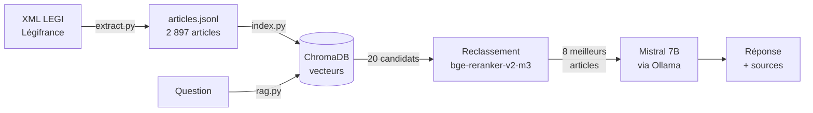

# RAG Lois : poser des questions sur le Code civil

Assistant qui répond à des questions de droit français **en citant les articles de loi** sur lesquels il s'appuie.
Projet de RAG (Retrieval-Augmented Generation) construit de A à Z, entièrement en local et gratuit.

> ⚠️ Information générale, pas un conseil juridique.

## Comment ça marche



1. **Extraction** (`extract.py`) : lit les fichiers XML open data de Légifrance (base LEGI) et garde les articles du Code civil en vigueur, avec les titres des parties du code qui les contiennent (Livre > Titre > Chapitre > Section).
2. **Indexation** (`index.py`) : transforme chaque article en vecteur avec le modèle `multilingual-e5-base`, puis le range dans ChromaDB. Les deux derniers niveaux de titre sont ajoutés au texte indexé (ex. art. 1875 : « Du prêt à usage, ou commodat »).
3. **Recherche** (`rag.py`) : transforme la question en vecteur, retrouve les 20 articles les plus proches par similarité cosinus, puis un cross-encoder (`bge-reranker-v2-m3`) relit chaque couple question-article et garde les 8 plus pertinents.
4. **Génération** (`rag.py`) : Mistral rédige la réponse uniquement à partir de ces articles, en les citant.
5. **Interface** (`app.py`) : une application web Flask qui affiche la réponse et des liens vers Légifrance.

## Stack

| Rôle | Outil |
|---|---|
| Données | Légifrance, base LEGI (open data) |
| Parsing XML | lxml |
| Embeddings | sentence-transformers, `intfloat/multilingual-e5-base` |
| Base vectorielle | ChromaDB (index HNSW) |
| Reclassement | cross-encoder `BAAI/bge-reranker-v2-m3` (GPU Apple via MPS si disponible) |
| LLM | Mistral 7B via Ollama (local) |
| Web | Flask + HTML/JS |

## Résultats

Évaluation de la recherche sur **47 questions** de la vie courante dont on connaît l'article attendu (`tests.json`, `eval.py`), avec la mesure **hit rate@k** : le bon article est-il dans les k premiers résultats ? Le Top-8 compte le plus, car ce sont ces 8 articles que reçoit Mistral.

| Version | Top-1 | Top-3 | Top-8 |
|---|---|---|---|
| Recherche vectorielle seule | 51 % | 62 % | 72 % |
| + titres de section dans le texte indexé | 49 % | 68 % | 74 % |
| + reclassement (`bge-reranker-v2-m3`, 20 candidats) | **55 %** | **74 %** | **81 %** |

**Ce que l'analyse des échecs a montré :** les articles ratés sont tous bien dans l'index. Le problème est l'**écart de vocabulaire** : la question emploie un mot courant (« prêter sa voiture », « déshériter », « union libre ») et l'article un terme juridique (« prêt à usage », « réserve héréditaire », « concubinage »).
- Les **titres de section** (« Du prêt à usage », « Du cautionnement ») apportent ce vocabulaire. Ajouter seulement les 2 derniers niveaux, sans « Chapitre II : », donne le meilleur compromis ; les niveaux supérieurs (Livre, Titre), communs à des centaines d'articles, dégradent le classement.
- Le **reclassement** fait le plus gros du gain. 20 candidats suffisent (même résultat qu'avec 50), pour environ 1,2 s de plus par question sur puce Apple. Un petit cross-encoder (`mmarco-mMiniLMv2`) a été testé et écarté : il dégradait le Top-1 et le Top-3.
- La **reformulation de la question par Mistral** (« prêter ma voiture » → terme juridique, avant la recherche) a été testée et écartée : au mieux ±1 question sur 47, pour environ 0,9 s de plus. Mistral 7B ne connaît pas assez le vocabulaire juridique : il paraphrase (« contrat de prêt de voiture » au lieu de « prêt à usage ») ou se trompe (« déshériter » → « légitimation » au lieu de « réserve héréditaire »). Le code reste dans `rag.py` (`REFORMULATION = False`).

**Le bug trouvé grâce à l'évaluation (première version, 7 questions) :** l'article 9 (« Chacun a droit au respect de sa vie privée ») n'apparaissait pas dans le top 100, alors que la question reprenait presque ses mots.
Diagnostic pas à pas :
- vecteur stocké correct ;
- score de l'article (0.855) supérieur à celui du 1er résultat renvoyé (0.827) ;
- conclusion : la recherche approximative HNSW de ChromaDB passait à côté (`search_ef` = 10 par défaut).

Correction : `search_ef` et `construction_ef` à 200, `M` à 32. L'article 9 est désormais classé 1er.

## Limites connues

- **Un seul code** : seul le Code civil est indexé. Une question sur le droit de vote (Code électoral) obtient une réponse approximative.
- **Écart de vocabulaire, en partie seulement comblé** : 9 questions sur 47 ne retrouvent toujours pas leur article dans le top 8, par exemple « si je prête ma voiture à un ami » (art. 1875, prêt à usage) ou « peut-on déshériter ses enfants » (art. 912, réserve héréditaire).
- **Petit modèle** : Mistral 7B suit imparfaitement les consignes. Il lui arrive de mal attribuer une citation ou d'oublier l'avertissement.
- **Évaluation encore modeste** : 47 questions, donc 1 question = environ 2 points de pourcentage. Les écarts de 1 ou 2 questions entre deux versions sont à prendre avec prudence.
- **Temps de réponse** : le reclassement ajoute environ 1,2 s par question sur puce Apple (environ 2,8 s sur CPU). Il se désactive avec `RECLASSEMENT = False` dans `rag.py`.

## Pistes d'amélioration

- Reformuler la question en termes juridiques avec un modèle plus fort que Mistral 7B (Claude, ou un modèle local plus gros) : essai fait avec Mistral, sans gain.
- Recherche hybride (vecteurs + BM25 par mots-clés).
- Comparer Mistral et Claude sur la qualité des citations.
- Indexer tous les codes.

## Installation (macOS)

Prérequis : Python 3.12 et [Ollama](https://ollama.com).

```bash
git clone https://github.com/AmineAmghar1705/Rag-Lois.git
cd Rag-Lois
python3.12 -m venv .venv
source .venv/bin/activate
pip install -r requirements.txt
ollama pull mistral
```

Télécharger l'archive `Freemium_legi_global_*.tar.gz` depuis [l'open data DILA](https://echanges.dila.gouv.fr/OPENDATA/LEGI/) et la décompresser dans `data/raw/`.

```bash
python extract.py   # crée data/articles.jsonl
python index.py     # crée la base chroma/ (à lancer avant rag.py)
                    # au premier lancement, rag.py télécharge le reclasseur (~2,3 Go)
python eval.py      # mesure la qualité de la recherche
python app.py       # puis ouvrir http://localhost:5001
```

## Données

Textes issus de la base LEGI (DILA / Légifrance), publiés sous Licence Ouverte Etalab.